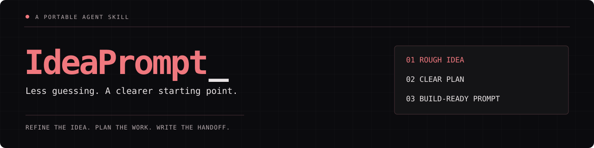
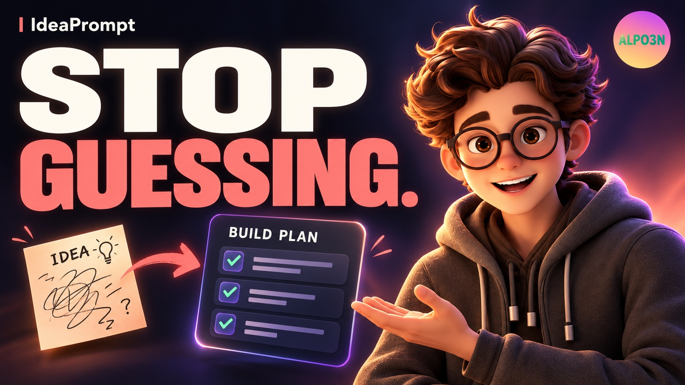

# IdeaPrompt

**Give your coding agent a clear starting point.**

IdeaPrompt turns rough ideas into refined briefs, practical implementation plans and reviewed execution prompts. Install it as an Agent Skill and use it in Codex, Claude Code or another assistant that supports the format.

**Your assistant does the reasoning. No separate API key, model-provider call or running website is required.** Your host assistant's normal limits still apply.

[Demo](#demo) · [Install](#installation) · [Compatibility](#compatibility) · [Usage](#usage) · [What you get](#what-you-get) · [Website version](#website-version)

## Demo

[](https://youtu.be/93S4EA61Gzg)

**[Watch the 83-second demo by ALPO3N on YouTube](https://youtu.be/93S4EA61Gzg)** · [Download the MP4](https://github.com/adii-madhavi/ideaprompt/raw/refs/heads/main/assets/demo/ideaprompt-demo-v2.mp4)

Follow a beginner's browser racing-game idea through clarification, planning, a coding-agent handoff and review. The 1080p video features a reference-inspired 3D-style animated presenter, ElevenLabs narration, captions, music and transitions. The interfaces are illustrative examples, not a recording of a tested agent session; presenter expressions follow the audio rather than phoneme-level lip-sync.

## What it does

| You bring | IdeaPrompt helps produce |
| --- | --- |
| A half-formed idea | A clear problem, intended users and a feasible first release |
| A project you want to build | An ordered plan, proposed file structure and acceptance criteria |
| A handoff to a coding agent | A self-contained prompt with requirements, constraints and checks |
| A change to an existing repository | A focused plan that follows its conventions and preserves unrelated behavior |

Choose a **quick draft** to proceed with labeled assumptions, or **clarify first** to answer up to three questions that materially affect the plan. Confirmed answers carry forward; the workflow does not restart the interview every turn.

## Installation

Install the **whole `skills/ideaprompt/` folder**, including `references/`. Copying only `SKILL.md` leaves the execution-prompt outline and review checklist behind.

### Codex

Ask Codex:

```text
Use $skill-installer to install https://github.com/adii-madhavi/ideaprompt/tree/main/skills/ideaprompt
```

Start a new session after installation, then use:

```text
Use $ideaprompt to turn my idea into a practical implementation plan.
```

For manual repository-scoped installation, copy the skill folder to `.agents/skills/ideaprompt/`. See the [official Codex skills guide](https://learn.chatgpt.com/docs/build-skills) for discovery and installation options.

### Claude Code

Download or clone this repository:

```sh
git clone https://github.com/adii-madhavi/ideaprompt.git
```

Copy `skills/ideaprompt/` from the clone into either of these locations:

| Scope | Destination |
| --- | --- |
| One project | `<your-project>/.claude/skills/ideaprompt/` |
| All local projects | `~/.claude/skills/ideaprompt/` |

On Windows, `~` is your user home, for example `C:\Users\YourName`. Preserve any existing skill with the same name before replacing it.

In Claude Code, invoke:

```text
/ideaprompt Plan a small browser car-racing game for a beginner.
```

Claude Code supports `SKILL.md` skills and slash-command invocation. See its [official skills documentation](https://code.claude.com/docs/en/skills).

### Other agents

Use the agent's documented skill importer or copy the complete folder to its supported skills directory. Invocation syntax and automatic discovery vary. The core instructions use the [open Agent Skills format](https://agentskills.io/specification); `agents/openai.yaml` is optional Codex display metadata.

An assistant without native skill support can read `SKILL.md` and the linked references as supplied instructions, but that does not provide automatic discovery or installation.

## Compatibility

| Environment | Support and verification |
| --- | --- |
| Codex | Includes installation guidance and display metadata. Skill structure and references validated. |
| Claude Code | Uses its documented skill format; includes installation and invocation instructions. Tested in Claude Code (desktop app, Claude Opus 5.5, October 2026): installed to `~/.claude/skills/ideaprompt/`, discovered without a restart, and passed the static-portfolio and volunteer-checklist [behavioral scenarios](evaluations/scenarios.md). Other scenarios not yet run in Claude Code. |
| Other Agent Skills-compatible agents | Portable instruction format; installation, tool availability and behavior depend on the host. Not individually tested. |
| Assistants without skill support | Manual instruction use only; no automatic skill discovery. |

**Portable does not mean identical behavior in every model or agent.** IdeaPrompt does not require Codex-specific tools, a particular model, an MCP connection or access to the old website database.

## Usage

The examples below use Codex's `$ideaprompt` form. In Claude Code, start with `/ideaprompt` instead.

### Refine an idea

```text
Use $ideaprompt to refine a neighborhood tool-sharing service.
Help me define the problem, users and smallest useful first version.
```

### Clarify before planning

```text
Use $ideaprompt in clarify-first mode. I want a hub of browser games
funded by ads and sponsorships. I'm new to development.
Help me choose a manageable first release.
```

### Make a practical plan

```text
Use $ideaprompt for a quick implementation plan for a photography portfolio.
Keep it static, inexpensive and easy to maintain. Include a file tree.
```

### Write a coding-agent handoff

```text
Use $ideaprompt to write an execution prompt for adding CSV export
to this repository. Inspect the current flow, preserve the UI and storage
format, and include acceptance criteria and verification steps.
```

Name a destination tool when useful. Choosing Claude Code as the destination of a generated prompt is separate from running the skill inside Claude Code.

## What you get

| Mode | Deliverable |
| --- | --- |
| **Refine** | A clear concept, users, core workflow, boundaries, assumptions and unresolved decisions |
| **Plan** | A brief, ordered implementation steps, appropriate architecture, proposed file/document tree and checks |
| **Prompt** | A self-contained build handoff covering scope, stack, files, data, security, accessibility, operations, phases and acceptance criteria |

For software plans and prompts, IdeaPrompt reviews applicable requirements and verification steps. Coverage is labeled **specified**, **missing** or **not applicable**, with supporting evidence or a reason. This is a specification review, not proof that an implementation is secure or tested.

A static site stays simple. Accounts, databases and payments need a project requirement. A raw idea can become a script, service, operational workflow or document instead of a website. Existing-project work follows the repository's actual conventions.

The skill stops at the requested planning artifact unless you also authorize implementation. It does not silently save personal preferences, train a model, create persistent memory or send project content to another inference provider. Content supplied to your host assistant remains subject to that host's data handling.

## Website version

| Branch | Purpose |
| --- | --- |
| [`main`](https://github.com/adii-madhavi/ideaprompt/tree/main) | The portable skill and its documentation |
| [`codex/website`](https://github.com/adii-madhavi/ideaprompt/tree/codex/website) | The preserved Next.js website and its run instructions |

To work on the website, preserve any uncommitted work, then switch branches:

```sh
git fetch origin
git switch codex/website
```

Read that branch's README for setup. Website projects, preferences and version history are not automatically imported into the skill. Ignored `.env` and `data/` files remain private local files; use the intended database path when running the website. Earlier website revisions remain in Git history.

## Inside the skill

```text
skills/ideaprompt/
  SKILL.md                         # Workflow and invocation guidance
  agents/openai.yaml               # Optional Codex display metadata
  references/
    execution-prompt.md            # Coding handoff outline
    engineering-review.md          # Applicable controls and coverage rules
evaluations/scenarios.md            # Manual behavioral acceptance cases
```

Read the [skill](skills/ideaprompt/SKILL.md), [execution-prompt outline](skills/ideaprompt/references/execution-prompt.md), or [engineering-review checklist](skills/ideaprompt/references/engineering-review.md).

## Contributing and validation

Keep changes focused on clearer decisions, useful deliverables and preserved user intent. Keep credentials, personal examples, database files and generated build artifacts out of commits. Follow [AGENTS.md](AGENTS.md) when editing the skill.

Validate frontmatter, relative reference links and display metadata after changes. Use the [behavioral scenarios](evaluations/scenarios.md) to assess scope preservation, clarification, file structures and honest review. They are manual acceptance cases, not an automated test runner. Report the agent/model and observed outcomes when evaluating behavior; structural validation alone does not establish cross-agent runtime compatibility.
